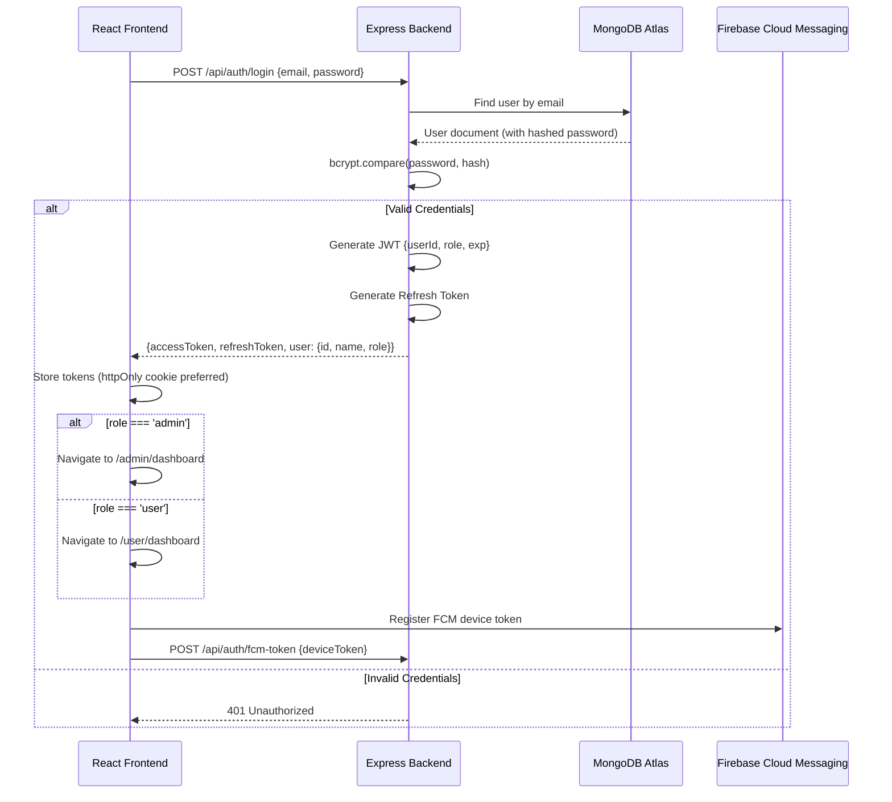
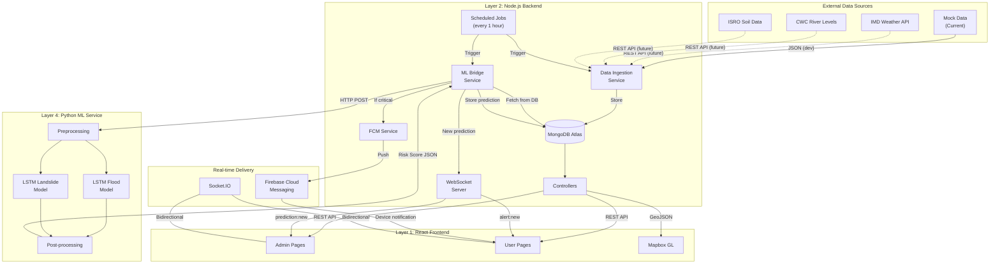

# AegisCore — Disaster Intelligence Platform Architecture Plan

## 1. Stitch Screen Inventory

The Stitch project contains **21 total screen instances** (13 visible, 8 hidden). After analysis, the hidden screens are earlier iterations/drafts of screens that were later refined. The **13 active (visible) screens** are the canonical designs to implement.

### Active Screens (Visible — 13)

| # | Stitch Screen ID | Title | Dimensions | Role |
|---|-----------------|-------|------------|------|
| 1 | `15b80d67be09…` | Disaster Dashboard with SOS Summary | 780×1768 | **ADMIN** |
| 2 | `447f99ba91db…` | Risk Analysis — Kodagu | 780×4580 | **ADMIN** |
| 3 | `321c853a1c29…` | Active Alerts | 780×2524 | **ADMIN** |
| 4 | `ac73724c3649…` | AI Prediction Center | 780×3808 | **ADMIN** |
| 5 | `9b0bbf1eafe9…` | Emergency Response (Admin) | 780×4404 | **ADMIN** |
| 6 | `ba271548d7ac…` | Shelter Management (Admin) | 780×4356 | **ADMIN** |
| 7 | `abb0072657fa…` | Profile & Settings (Admin) | 780×4252 | **ADMIN** |
| 8 | `5b148976be01…` | Citizen Safety Dashboard Refined | 780×4748 | **USER** |
| 9 | `4b8b51818992…` | Risk & Disaster Map | 780×2456 | **USER** |
| 10 | `7771c0b3efeb…` | Alerts & Notifications | 780×2972 | **USER** |
| 11 | `2fc048323f55…` | Emergency SOS | 780×2028 | **USER** |
| 12 | `58a08d58ac7c…` | Safe Shelters | 780×1768 | **USER** |
| 13 | `1eb9c1486a2c…` | Profile & Settings | 780×6172 | **USER** |

### Hidden Screens (Earlier Drafts — 8)

These are superseded versions. They will **NOT** be implemented but are preserved in Stitch for reference.

| # | Stitch Screen ID | Title | Notes |
|---|-----------------|-------|-------|
| H1 | `03cfaec92871…` | Map-First Disaster Dashboard | Early admin dashboard draft |
| H2 | `06061d6dffcb…` | Disaster Dashboard | Earlier admin dashboard |
| H3 | `ffd31291a057…` | Disaster Dashboard Refined | Intermediate admin dashboard |
| H4 | `3998d7cdf87d…` | Citizen Safety Dashboard | Earlier user dashboard |
| H5 | `1346ac6cd26c…` | Citizen Safety Dashboard | Another user dashboard draft |
| H6 | `b67b2c4d011c…` | Emergency / SOS Management (Admin) | Earlier admin emergency screen |
| H7 | `342f0808c7da…` | Risk & Disaster Map (Geographical Update) | Map iteration |
| H8 | `a4104d135af0…` | Risk & Disaster Map (Corrected) | Map iteration |

---

## 2. Screen-to-Role Mapping

### ADMIN Screens (7 screens)

| Stitch Screen | Application Page | Route |
|--------------|-----------------|-------|
| Disaster Dashboard with SOS Summary | Admin Dashboard | `/admin/dashboard` |
| Risk & Disaster Map *(shared design, admin variant)* | Admin Risk Map | `/admin/risk-map` |
| Risk Analysis — Kodagu | Admin Risk Analysis | `/admin/risk-analysis` |
| Active Alerts | Admin Active Alerts | `/admin/alerts` |
| AI Prediction Center | Admin AI Predictions | `/admin/predictions` |
| Emergency Response (Admin) | Admin Emergency Management | `/admin/emergency` |
| Shelter Management (Admin) | Admin Shelter Management | `/admin/shelters` |
| Profile & Settings (Admin) | Admin Profile & Settings | `/admin/profile` |

> [!NOTE]
> The Admin Dashboard (Disaster Dashboard with SOS Summary) includes an embedded map with a 60% viewport allocation, environmental condition cards (Rainfall, River Level, Soil Moisture), Critical Zone alerts, and an Emergency SOS status panel. The bottom nav has: Dashboard, Alerts, Emergency, Shelters, More.

### USER/CITIZEN Screens (6 screens)

| Stitch Screen | Application Page | Route |
|--------------|-----------------|-------|
| Citizen Safety Dashboard Refined | User Dashboard | `/user/dashboard` |
| Risk & Disaster Map | User Risk Map | `/user/risk-map` |
| Alerts & Notifications | User Alerts | `/user/alerts` |
| Emergency SOS | User Emergency SOS | `/user/emergency` |
| Safe Shelters | User Safe Shelters | `/user/shelters` |
| Profile & Settings | User Profile & Settings | `/user/profile` |

> [!IMPORTANT]
> The Admin has an additional screen (**AI Prediction Center**) that users do not have. The Admin's Risk Map is a more advanced version with admin controls, while the User gets a read-only version. The Admin Dashboard includes SOS management summary, while the User Dashboard focuses on personal safety.

---

## 3. Screens NOT in Stitch (Must Be Created Separately)

The following screens are **required by the functional requirements** but are **not present** in the current Stitch project:

| Screen | Purpose | Notes |
|--------|---------|-------|
| **Login / Sign In** | Authentication entry point | Email/password + optional social login |
| **Registration / Sign Up** | New user account creation | Role assignment (default: USER) |
| **Forgot Password** | Password recovery flow | Email-based reset |
| **Onboarding / Welcome** | First-time user experience | Location permissions, notification permissions |
| **Admin Risk Map** | Full-screen admin map view | The Admin Dashboard has an embedded map, but a dedicated full-screen risk map page for admins should be implemented as well, reusing the map components |
| **404 / Error Page** | Route not found handler | Shared across roles |
| **Loading / Splash Screen** | App initialization | JWT validation, role resolution |

> [!WARNING]
> The **Login/Registration** screens are the most critical missing piece. These must be designed to match the existing AegisCore design system (dark mode, glassmorphism, Inter/JetBrains Mono typography, `#38BDF8` primary cyan) before implementation begins. I recommend generating these in Stitch to maintain design consistency.

---

## 4. Proposed Project Folder Structure

```
AegisCore/
├── frontend/                          # React + Vite + Tailwind
│   ├── public/
│   │   ├── favicon.ico
│   │   └── manifest.json
│   ├── src/
│   │   ├── assets/                    # Static images, icons, fonts
│   │   │   ├── images/
│   │   │   └── icons/
│   │   ├── components/                # Shared/reusable components
│   │   │   ├── ui/                    # Atomic UI elements
│   │   │   │   ├── Button.jsx
│   │   │   │   ├── Card.jsx
│   │   │   │   ├── StatusChip.jsx
│   │   │   │   ├── GlassPanel.jsx
│   │   │   │   ├── DataCard.jsx
│   │   │   │   └── Input.jsx
│   │   │   ├── map/                   # Map-related components
│   │   │   │   ├── MapView.jsx
│   │   │   │   ├── RiskZoneLayer.jsx
│   │   │   │   ├── ShelterMarkers.jsx
│   │   │   │   ├── SOSMarkers.jsx
│   │   │   │   └── MapControls.jsx
│   │   │   ├── charts/                # Data visualization
│   │   │   │   ├── RiskGauge.jsx
│   │   │   │   ├── TimeSeriesChart.jsx
│   │   │   │   └── PredictionChart.jsx
│   │   │   └── layout/                # Layout components
│   │   │       ├── AdminLayout.jsx    # Admin shell (header + bottom nav)
│   │   │       ├── UserLayout.jsx     # User shell (header + bottom nav)
│   │   │       ├── Header.jsx
│   │   │       ├── BottomNav.jsx
│   │   │       └── ProtectedRoute.jsx
│   │   ├── pages/                     # Route-level page components
│   │   │   ├── auth/                  # Authentication pages
│   │   │   │   ├── Login.jsx
│   │   │   │   ├── Register.jsx
│   │   │   │   └── ForgotPassword.jsx
│   │   │   ├── admin/                 # Admin pages
│   │   │   │   ├── Dashboard.jsx
│   │   │   │   ├── RiskMap.jsx
│   │   │   │   ├── RiskAnalysis.jsx
│   │   │   │   ├── ActiveAlerts.jsx
│   │   │   │   ├── AIPredictions.jsx
│   │   │   │   ├── EmergencyManagement.jsx
│   │   │   │   ├── ShelterManagement.jsx
│   │   │   │   └── Profile.jsx
│   │   │   ├── user/                  # User/Citizen pages
│   │   │   │   ├── Dashboard.jsx
│   │   │   │   ├── RiskMap.jsx
│   │   │   │   ├── Alerts.jsx
│   │   │   │   ├── EmergencySOS.jsx
│   │   │   │   ├── SafeShelters.jsx
│   │   │   │   └── Profile.jsx
│   │   │   └── shared/                # Shared pages
│   │   │       ├── NotFound.jsx
│   │   │       └── Loading.jsx
│   │   ├── hooks/                     # Custom React hooks
│   │   │   ├── useAuth.js
│   │   │   ├── useWebSocket.js
│   │   │   ├── useMap.js
│   │   │   ├── useAlerts.js
│   │   │   └── useGeolocation.js
│   │   ├── services/                  # API & data abstraction layer
│   │   │   ├── api.js                 # Axios instance + interceptors
│   │   │   ├── authService.js
│   │   │   ├── alertService.js
│   │   │   ├── weatherService.js      # ← Swappable data interface
│   │   │   ├── riskService.js
│   │   │   ├── shelterService.js
│   │   │   ├── sosService.js
│   │   │   ├── predictionService.js
│   │   │   └── notificationService.js
│   │   ├── context/                   # React Context providers
│   │   │   ├── AuthContext.jsx
│   │   │   ├── AlertContext.jsx
│   │   │   └── WebSocketContext.jsx
│   │   ├── utils/                     # Utility functions
│   │   │   ├── constants.js
│   │   │   ├── riskLevels.js          # Risk color/label mapping
│   │   │   ├── formatters.js
│   │   │   └── validators.js
│   │   ├── styles/                    # Global styles
│   │   │   └── index.css              # Tailwind directives + custom CSS
│   │   ├── App.jsx                    # Root component + router
│   │   ├── main.jsx                   # Entry point
│   │   └── router.jsx                 # Route definitions
│   ├── index.html
│   ├── tailwind.config.js             # AegisCore design system tokens
│   ├── postcss.config.js
│   ├── vite.config.js
│   ├── package.json
│   └── .env                           # VITE_API_URL, VITE_MAPBOX_TOKEN, etc.
│
├── backend/                           # Node.js + Express
│   ├── src/
│   │   ├── config/
│   │   │   ├── db.js                  # MongoDB Atlas connection
│   │   │   ├── firebase.js            # Firebase Admin SDK init
│   │   │   └── env.js                 # Environment variable loader
│   │   ├── middleware/
│   │   │   ├── auth.js                # JWT verification middleware
│   │   │   ├── roleGuard.js           # Role-based access control
│   │   │   ├── errorHandler.js        # Global error handler
│   │   │   ├── rateLimiter.js         # Rate limiting
│   │   │   └── validator.js           # Request validation
│   │   ├── models/                    # Mongoose schemas
│   │   │   ├── User.js
│   │   │   ├── Alert.js
│   │   │   ├── RiskPrediction.js
│   │   │   ├── WeatherData.js
│   │   │   ├── RiverData.js
│   │   │   ├── SoilData.js
│   │   │   ├── Shelter.js
│   │   │   ├── SOSRequest.js
│   │   │   ├── Volunteer.js
│   │   │   └── AuditLog.js
│   │   ├── routes/
│   │   │   ├── authRoutes.js
│   │   │   ├── adminRoutes.js         # Admin-only endpoints
│   │   │   ├── userRoutes.js          # User-facing endpoints
│   │   │   ├── alertRoutes.js
│   │   │   ├── riskRoutes.js
│   │   │   ├── shelterRoutes.js
│   │   │   ├── sosRoutes.js
│   │   │   ├── predictionRoutes.js
│   │   │   └── weatherRoutes.js
│   │   ├── controllers/
│   │   │   ├── authController.js
│   │   │   ├── adminController.js
│   │   │   ├── alertController.js
│   │   │   ├── riskController.js
│   │   │   ├── shelterController.js
│   │   │   ├── sosController.js
│   │   │   ├── predictionController.js
│   │   │   └── weatherController.js
│   │   ├── services/                  # Business logic layer
│   │   │   ├── authService.js
│   │   │   ├── alertService.js
│   │   │   ├── riskService.js
│   │   │   ├── shelterService.js
│   │   │   ├── sosService.js
│   │   │   ├── mlBridgeService.js     # ← Calls Flask ML service
│   │   │   ├── notificationService.js # Firebase Cloud Messaging
│   │   │   └── dataIngestionService.js # ← Swappable data interface
│   │   ├── websocket/
│   │   │   ├── socketServer.js        # WebSocket server setup
│   │   │   ├── handlers/
│   │   │   │   ├── alertHandler.js    # Real-time alert broadcasts
│   │   │   │   ├── sosHandler.js      # SOS event handling
│   │   │   │   └── mapHandler.js      # Live map data updates
│   │   │   └── rooms.js              # Room management (admin/user)
│   │   ├── jobs/                      # Scheduled background tasks
│   │   │   ├── dataFetchJob.js        # Periodic data ingestion
│   │   │   ├── predictionJob.js       # Trigger ML predictions
│   │   │   └── alertCleanupJob.js     # Expired alert cleanup
│   │   └── utils/
│   │       ├── logger.js
│   │       ├── responseHelper.js
│   │       └── geoUtils.js            # Haversine, bounding box, etc.
│   ├── server.js                      # Express app entry point
│   ├── package.json
│   ├── .env                           # MONGO_URI, JWT_SECRET, ML_SERVICE_URL, etc.
│   └── nodemon.json
│
├── ml-service/                        # Python + Flask + TensorFlow
│   ├── app/
│   │   ├── __init__.py                # Flask app factory
│   │   ├── config.py                  # Configuration
│   │   ├── routes/
│   │   │   ├── __init__.py
│   │   │   ├── prediction_routes.py   # /predict, /retrain, /status
│   │   │   └── health_routes.py       # /health
│   │   ├── models/                    # ML model definitions
│   │   │   ├── __init__.py
│   │   │   ├── flood_model.py         # LSTM flood prediction
│   │   │   ├── landslide_model.py     # LSTM landslide prediction
│   │   │   └── base_model.py          # Abstract model interface
│   │   ├── services/
│   │   │   ├── __init__.py
│   │   │   ├── prediction_service.py  # Orchestrates predictions
│   │   │   ├── preprocessing.py       # Data normalization, windowing
│   │   │   └── model_registry.py      # Model versioning/loading
│   │   ├── data/
│   │   │   ├── mock/                  # Mock datasets for dev
│   │   │   │   ├── weather_mock.json
│   │   │   │   ├── river_mock.json
│   │   │   │   └── soil_mock.json
│   │   │   └── schemas/               # Data validation schemas
│   │   │       └── input_schema.py
│   │   └── utils/
│   │       ├── logger.py
│   │       └── metrics.py
│   ├── trained_models/                # Saved model weights (.h5/.keras)
│   │   └── .gitkeep
│   ├── notebooks/                     # Jupyter notebooks for experimentation
│   │   └── .gitkeep
│   ├── requirements.txt
│   ├── Dockerfile
│   ├── run.py                         # Entry point
│   └── .env                           # MODEL_PATH, etc.
│
├── shared/                            # Shared constants/types
│   ├── risk-levels.json               # Risk tier definitions
│   ├── district-codes.json            # Karnataka district reference
│   └── api-contracts.md               # API contract documentation
│
├── docs/                              # Project documentation
│   ├── architecture.md
│   ├── api-reference.md
│   ├── deployment.md
│   └── stitch-screen-mapping.md
│
├── docker-compose.yml                 # Multi-service orchestration
├── .gitignore
├── README.md
└── package.json                       # Root workspace (optional monorepo)
```

---

## 5. Frontend Page Organization

### Admin Pages (`frontend/src/pages/admin/`)

Each admin page maps directly to a Stitch screen:

```
pages/admin/
├── Dashboard.jsx         ← "Disaster Dashboard with SOS Summary"
│                           Map (60vh), Env. Conditions strip, Critical Zones, SOS Summary
├── RiskMap.jsx           ← Admin-specific full-screen map with layer controls
│                           Heat zones, district overlays, risk markers
├── RiskAnalysis.jsx      ← "Risk Analysis — Kodagu"
│                           District detail view, risk scores, charts, recommendations
├── ActiveAlerts.jsx      ← "Active Alerts"
│                           Alert list with severity filters, create/edit alerts
├── AIPredictions.jsx     ← "AI Prediction Center"
│                           Model status, prediction timelines, confidence scores
├── EmergencyManagement.jsx ← "Emergency Response (Admin)"
│                           SOS request queue, volunteer dispatch, response coordination
├── ShelterManagement.jsx ← "Shelter Management (Admin)"
│                           Shelter CRUD, capacity tracking, resource allocation
└── Profile.jsx           ← "Profile & Settings (Admin)"
                            Admin account, system settings, notification preferences
```

### User Pages (`frontend/src/pages/user/`)

```
pages/user/
├── Dashboard.jsx         ← "Citizen Safety Dashboard Refined"
│                           Personal safety score, nearby risks, weather, quick actions
├── RiskMap.jsx           ← "Risk & Disaster Map"
│                           Read-only map, risk zones, shelter pins, SOS button
├── Alerts.jsx            ← "Alerts & Notifications"
│                           Push notification history, alert details, subscription prefs
├── EmergencySOS.jsx      ← "Emergency SOS"
│                           Big SOS trigger button, location sharing, status tracking
├── SafeShelters.jsx      ← "Safe Shelters"
│                           Nearest shelters list, map view, directions, capacity
└── Profile.jsx           ← "Profile & Settings"
                            Personal info, emergency contacts, notification settings
```

### Layout Architecture

Both roles share a **common layout pattern** from the Stitch designs:
- **Fixed header** (14px height): AegisCore logo + LIVE indicator (admin) or safety status (user)
- **Scrollable main content**: Page-specific content
- **Fixed bottom navigation** (20px height): Role-specific nav items

```jsx
// AdminLayout wraps all /admin/* routes
<AdminLayout>
  <Header role="admin" />
  <main>{/* Page content via <Outlet /> */}</main>
  <BottomNav items={adminNavItems} />
</AdminLayout>

// UserLayout wraps all /user/* routes
<UserLayout>
  <Header role="user" />
  <main>{/* Page content via <Outlet /> */}</main>
  <BottomNav items={userNavItems} />
</UserLayout>
```

**Admin Bottom Nav items** (from Stitch): Dashboard | Alerts | Emergency | Shelters | More
**User Bottom Nav items** (from Stitch): Dashboard | Map | SOS | Shelters | More

---

## 6. Route Structure

```jsx
// router.jsx — React Router v6

/                              → Redirect to /login (if unauthenticated)
                                 or /admin/dashboard | /user/dashboard (based on role)

/login                         → Login page
/register                      → Registration page
/forgot-password               → Password recovery

/admin/*                       → Protected: role === 'admin'
  /admin/dashboard             → Admin Dashboard
  /admin/risk-map              → Admin Risk & Disaster Map
  /admin/risk-analysis         → Admin Risk Analysis
  /admin/risk-analysis/:districtId → District-specific analysis (e.g. Kodagu)
  /admin/alerts                → Admin Active Alerts
  /admin/predictions           → Admin AI Prediction Center
  /admin/emergency             → Admin Emergency Management
  /admin/shelters              → Admin Shelter Management
  /admin/profile               → Admin Profile & Settings

/user/*                        → Protected: role === 'user'
  /user/dashboard              → User/Citizen Dashboard
  /user/risk-map               → User Risk & Disaster Map
  /user/alerts                 → User Alerts & Notifications
  /user/emergency              → User Emergency SOS
  /user/shelters               → User Safe Shelters
  /user/profile                → User Profile & Settings

/*                             → 404 Not Found
```

---

## 7. Authentication & Role-Based Access

### Authentication Flow



### Token Strategy

| Token | Purpose | Storage | Expiry |
|-------|---------|---------|--------|
| Access Token (JWT) | API authentication | httpOnly cookie or memory | 15 minutes |
| Refresh Token | Token renewal | httpOnly cookie | 7 days |
| FCM Device Token | Push notifications | Backend DB | Until device unregisters |

### Role Guard — Backend Middleware

```javascript
// middleware/roleGuard.js
const roleGuard = (...allowedRoles) => {
  return (req, res, next) => {
    if (!req.user) return res.status(401).json({ error: 'Not authenticated' });
    if (!allowedRoles.includes(req.user.role)) {
      return res.status(403).json({ error: 'Insufficient permissions' });
    }
    next();
  };
};

// Usage:
router.get('/admin/alerts', auth, roleGuard('admin'), alertController.getAll);
router.get('/user/alerts',  auth, roleGuard('user'),  alertController.getUserAlerts);
```

### Route Protection — Frontend

```jsx
// ProtectedRoute.jsx
const ProtectedRoute = ({ allowedRoles, children }) => {
  const { user, isLoading } = useAuth();
  
  if (isLoading) return <LoadingScreen />;
  if (!user) return <Navigate to="/login" />;
  if (!allowedRoles.includes(user.role)) {
    return <Navigate to={user.role === 'admin' ? '/admin/dashboard' : '/user/dashboard'} />;
  }
  return children;
};
```

---

## 8. MongoDB Collections

### Collection Schema Design

```
┌─────────────────────────────────────────────────────┐
│ DATABASE: aegiscore                                  │
├─────────────────────────────────────────────────────┤
│                                                      │
│  users               — User accounts & profiles     │
│  alerts              — Disaster alerts (all types)   │
│  risk_predictions    — ML model output               │
│  weather_data        — Rainfall, temperature, etc.   │
│  river_data          — River levels & flow rates     │
│  soil_data           — Soil moisture readings        │
│  shelters            — Shelter locations & capacity  │
│  sos_requests        — Emergency SOS submissions     │
│  volunteers          — Registered volunteer profiles │
│  notifications       — Push notification log         │
│  audit_logs          — System activity log           │
│  districts           — Geographic district metadata  │
│                                                      │
└─────────────────────────────────────────────────────┘
```

### Detailed Schema Definitions

#### `users`
```javascript
{
  _id: ObjectId,
  email: String,              // unique, indexed
  passwordHash: String,
  role: String,               // enum: ['admin', 'user']
  profile: {
    name: String,
    phone: String,
    avatar: String,
    address: {
      district: String,
      city: String,
      state: String,          // Default: "Karnataka"
      pincode: String
    }
  },
  location: {                 // Last known location
    type: "Point",
    coordinates: [Number, Number]  // [lng, lat] — GeoJSON
  },
  emergencyContacts: [{
    name: String,
    phone: String,
    relationship: String
  }],
  fcmTokens: [String],       // Firebase device tokens
  notificationPreferences: {
    pushEnabled: Boolean,
    alertTypes: [String],     // ['flood', 'landslide', 'earthquake']
    minSeverity: String       // 'low' | 'moderate' | 'high' | 'critical'
  },
  isActive: Boolean,
  lastLogin: Date,
  createdAt: Date,
  updatedAt: Date
}
// Indexes: { email: 1 }, { location: "2dsphere" }, { role: 1 }
```

#### `alerts`
```javascript
{
  _id: ObjectId,
  type: String,               // enum: ['flood', 'landslide', 'earthquake', 'cyclone', 'general']
  severity: String,           // enum: ['low', 'moderate', 'high', 'critical']
  title: String,
  description: String,
  district: String,           // "Kodagu", "Udupi", etc.
  affectedArea: {
    type: "Polygon",
    coordinates: [[[Number, Number]]]  // GeoJSON Polygon
  },
  epicenter: {
    type: "Point",
    coordinates: [Number, Number]
  },
  isActive: Boolean,
  source: String,             // 'ai_prediction' | 'manual' | 'external_api'
  linkedPrediction: ObjectId, // ref → risk_predictions
  issuedBy: ObjectId,         // ref → users (admin who created it)
  issuedAt: Date,
  expiresAt: Date,
  updatedAt: Date
}
// Indexes: { district: 1, severity: 1 }, { affectedArea: "2dsphere" }, { isActive: 1 }
```

#### `risk_predictions`
```javascript
{
  _id: ObjectId,
  district: String,
  predictionType: String,     // 'flood' | 'landslide'
  riskScore: Number,          // 0.0 — 1.0
  riskLevel: String,          // 'low' | 'moderate' | 'high' | 'critical'
  confidence: Number,         // 0.0 — 1.0
  modelVersion: String,       // e.g. "flood_lstm_v2.1"
  inputData: {
    rainfall_mm: Number,
    river_level_m: Number,
    soil_moisture_pct: Number,
    temperature_c: Number,
    humidity_pct: Number,
    window_hours: Number      // Time window for prediction
  },
  predictionWindow: {
    start: Date,
    end: Date                 // Prediction valid until
  },
  generatedAt: Date,
  metadata: Mixed             // Additional model-specific data
}
// Indexes: { district: 1, generatedAt: -1 }, { riskLevel: 1 }
```

#### `weather_data`
```javascript
{
  _id: ObjectId,
  district: String,
  station: String,            // Weather station name
  timestamp: Date,
  rainfall_mm: Number,
  temperature_c: Number,
  humidity_pct: Number,
  wind_speed_kmh: Number,
  wind_direction: String,
  pressure_hpa: Number,
  source: String,             // 'imd' | 'openweather' | 'mock'
  createdAt: Date
}
// Indexes: { district: 1, timestamp: -1 }, TTL: { createdAt: 90 days }
```

#### `river_data`
```javascript
{
  _id: ObjectId,
  district: String,
  riverName: String,
  station: String,
  timestamp: Date,
  level_m: Number,
  flowRate_cumecs: Number,
  dangerLevel_m: Number,
  warningLevel_m: Number,
  source: String,             // 'cwc' | 'mock'
  createdAt: Date
}
// Indexes: { district: 1, timestamp: -1 }
```

#### `soil_data`
```javascript
{
  _id: ObjectId,
  district: String,
  location: {
    type: "Point",
    coordinates: [Number, Number]
  },
  timestamp: Date,
  moisture_pct: Number,
  depth_cm: Number,
  soilType: String,
  saturationLevel: String,    // 'dry' | 'normal' | 'saturated' | 'supersaturated'
  source: String,
  createdAt: Date
}
// Indexes: { district: 1, timestamp: -1 }, { location: "2dsphere" }
```

#### `shelters`
```javascript
{
  _id: ObjectId,
  name: String,
  type: String,               // 'government' | 'community' | 'school' | 'temple'
  location: {
    type: "Point",
    coordinates: [Number, Number]
  },
  address: {
    street: String,
    district: String,
    city: String,
    pincode: String
  },
  capacity: {
    total: Number,
    current: Number
  },
  amenities: [String],        // ['water', 'food', 'medical', 'power', 'wifi']
  contactPerson: {
    name: String,
    phone: String
  },
  status: String,             // 'open' | 'full' | 'closed' | 'damaged'
  isVerified: Boolean,
  lastUpdated: Date,
  createdAt: Date
}
// Indexes: { location: "2dsphere" }, { status: 1, district: 1 }
```

> [!IMPORTANT]
> **Relief Shelter Coverage & Pilot Deployment Scope:**
> - **Initial Pilot Deployment:** The current release operates 16 verified shelter anchors (4 per monitored pilot district: Kodagu, Uttara Kannada, Belagavi, Bagalkot) anchored to real public infrastructure (government schools, junior colleges, taluk stadiums, community centers) positioned near primary river reach inundation points.
> - **Operational Field Requirement:** Full-scale production deployment requires formal District Disaster Management Authority (DDMA) coordination to establish verified relief center locations following National Disaster Management Authority (NDMA) shelter-density guidelines (~10–15 km coverage radius per high-risk settlement zone).

#### `sos_requests`
```javascript
{
  _id: ObjectId,
  userId: ObjectId,           // ref → users
  location: {
    type: "Point",
    coordinates: [Number, Number]
  },
  address: String,            // Reverse geocoded address
  emergencyType: String,      // 'flood' | 'landslide' | 'medical' | 'trapped' | 'other'
  description: String,
  numberOfPeople: Number,
  status: String,             // 'pending' | 'acknowledged' | 'responding' | 'resolved' | 'cancelled'
  priority: String,           // 'low' | 'medium' | 'high' | 'critical'
  assignedVolunteers: [{
    volunteerId: ObjectId,
    assignedAt: Date,
    eta: Number               // minutes
  }],
  resolvedBy: ObjectId,       // ref → users (admin)
  resolvedAt: Date,
  createdAt: Date,
  updatedAt: Date
}
// Indexes: { status: 1 }, { location: "2dsphere" }, { userId: 1 }
```

#### `volunteers`
```javascript
{
  _id: ObjectId,
  userId: ObjectId,           // ref → users
  skills: [String],           // ['first_aid', 'rescue', 'medical', 'transport']
  availability: String,       // 'available' | 'busy' | 'offline'
  location: {
    type: "Point",
    coordinates: [Number, Number]
  },
  responseRadius_km: Number,
  completedMissions: Number,
  rating: Number,
  isVerified: Boolean,
  createdAt: Date
}
// Indexes: { location: "2dsphere" }, { availability: 1 }
```

#### `notifications`
```javascript
{
  _id: ObjectId,
  recipientId: ObjectId,      // ref → users (null = broadcast)
  type: String,               // 'alert' | 'sos_update' | 'system' | 'prediction'
  title: String,
  body: String,
  data: Mixed,                // Custom payload
  channel: String,            // 'push' | 'in_app' | 'both'
  isRead: Boolean,
  sentAt: Date
}
// Indexes: { recipientId: 1, isRead: 1, sentAt: -1 }
```

#### `audit_logs`
```javascript
{
  _id: ObjectId,
  userId: ObjectId,
  action: String,             // 'CREATE_ALERT', 'DISPATCH_VOLUNTEER', etc.
  resource: String,           // 'alert', 'shelter', etc.
  resourceId: ObjectId,
  details: Mixed,
  ipAddress: String,
  timestamp: Date
}
// Indexes: { userId: 1, timestamp: -1 }, TTL: { timestamp: 365 days }
```

#### `districts`
```javascript
{
  _id: ObjectId,
  name: String,               // "Kodagu", "Udupi", etc.
  code: String,               // "KDG", "UDP"
  state: String,
  boundary: {
    type: "Polygon",
    coordinates: [[[Number, Number]]]
  },
  centroid: {
    type: "Point",
    coordinates: [Number, Number]
  },
  metadata: {
    population: Number,
    area_sqkm: Number,
    riskProfile: String       // Historical risk classification
  }
}
// Indexes: { name: 1 }, { boundary: "2dsphere" }
```

---

## 9. Node.js/Express API Structure

### API Route Map

```
BASE URL: /api/v1

── AUTH ──────────────────────────────────────
POST   /auth/register            → Create account
POST   /auth/login               → Login, returns JWT
POST   /auth/refresh             → Refresh access token
POST   /auth/logout              → Invalidate refresh token
POST   /auth/forgot-password     → Send reset email
POST   /auth/reset-password      → Reset with token
POST   /auth/fcm-token           → Register device for push

── ADMIN ROUTES (role: admin) ───────────────
GET    /admin/dashboard/summary  → Dashboard stats & SOS summary
GET    /admin/sos-requests       → All SOS requests
PATCH  /admin/sos-requests/:id   → Update SOS status / assign volunteer

── ALERTS ───────────────────────────────────
GET    /alerts                   → List alerts (filterable by district, severity, type)
GET    /alerts/:id               → Single alert detail
POST   /alerts                   → [Admin] Create alert
PATCH  /alerts/:id               → [Admin] Update alert
DELETE /alerts/:id               → [Admin] Deactivate alert

── RISK & PREDICTIONS ────────────────────────
GET    /risk/districts           → All districts with current risk levels
GET    /risk/districts/:id       → District-specific risk detail
GET    /risk/predictions         → Recent ML predictions
POST   /risk/predict             → [Admin] Trigger new prediction run
GET    /risk/map-data            → GeoJSON for map overlay (zones + severity)

── WEATHER / ENVIRONMENTAL DATA ──────────────
GET    /weather/current          → Current conditions (all districts)
GET    /weather/current/:district → Single district weather
GET    /weather/history/:district → Time-series data for charts
GET    /river/current            → Current river levels
GET    /river/current/:district  → Single district river data
GET    /soil/current             → Current soil moisture
GET    /soil/current/:district   → Single district soil data

── SHELTERS ──────────────────────────────────
GET    /shelters                 → List shelters (filterable, sortable by distance)
GET    /shelters/:id             → Single shelter detail
POST   /shelters                 → [Admin] Create shelter
PATCH  /shelters/:id             → [Admin] Update shelter
DELETE /shelters/:id             → [Admin] Delete shelter
GET    /shelters/nearby          → Nearest shelters to lat/lng (geo query)

── SOS ───────────────────────────────────────
POST   /sos                      → [User] Create SOS request
GET    /sos/my-requests          → [User] My SOS history
GET    /sos/:id                  → SOS detail (admin: any, user: own)
PATCH  /sos/:id/cancel           → [User] Cancel own SOS

── VOLUNTEERS ────────────────────────────────
GET    /volunteers               → [Admin] List volunteers
GET    /volunteers/nearby        → [Admin] Find nearest available volunteers
PATCH  /volunteers/:id/status    → [Admin] Update volunteer availability
POST   /volunteers/:id/dispatch  → [Admin] Dispatch to SOS request

── USER PROFILE ──────────────────────────────
GET    /users/me                 → Current user profile
PATCH  /users/me                 → Update profile
PATCH  /users/me/location        → Update user location
GET    /users/me/notifications   → In-app notification history
PATCH  /users/me/notifications/:id/read → Mark notification as read
```

### Controller Pattern

Each controller follows a standard pattern:

```javascript
// controllers/alertController.js
class AlertController {
  async getAll(req, res, next)    { /* query with filters */ }
  async getById(req, res, next)   { /* single alert */ }
  async create(req, res, next)    { /* admin only, triggers WebSocket broadcast */ }
  async update(req, res, next)    { /* admin only */ }
  async deactivate(req, res, next){ /* soft delete */ }
}
```

---

## 10. Flask/AI/ML Service Structure

### API Endpoints

```
BASE URL: http://localhost:5000/api/v1

── PREDICTIONS ──────────────────────────────
POST   /predict/flood            → Run flood prediction for a district
POST   /predict/landslide        → Run landslide prediction for a district
POST   /predict/batch            → Run predictions for all monitored districts

── MODEL MANAGEMENT ─────────────────────────
GET    /models                   → List available models & versions
GET    /models/:name/status      → Model status, last trained, accuracy
POST   /models/:name/retrain     → Trigger model retraining (async)

── HEALTH ───────────────────────────────────
GET    /health                   → Service health + GPU/memory status
```

### ML Pipeline Architecture

```
Input Data (from Node.js backend)
    │
    ▼
┌─────────────────────────┐
│   Preprocessing         │
│   • Normalize values    │
│   • Create time windows │
│   • Handle missing data │
│   • Feature engineering │
└───────────┬─────────────┘
            │
            ▼
┌─────────────────────────┐
│   LSTM Model            │
│   • Sequence length: 72h│
│   • Features: rainfall, │
│     river_level,         │
│     soil_moisture,       │
│     temperature,         │
│     humidity             │
│   • Output: risk score  │
│     (0.0 — 1.0)         │
└───────────┬─────────────┘
            │
            ▼
┌─────────────────────────┐
│   Post-processing       │
│   • Score → Risk Level  │
│   • Confidence interval │
│   • Recommendation gen  │
└───────────┬─────────────┘
            │
            ▼
Response JSON → Node.js Backend
```

### Prediction Request/Response Contract

```python
# Request (POST /predict/flood)
{
  "district": "Kodagu",
  "data": {
    "weather": [
      {"timestamp": "2026-08-09T00:00:00Z", "rainfall_mm": 45, "temperature_c": 24, "humidity_pct": 92},
      # ... 72 hours of hourly data
    ],
    "river": [
      {"timestamp": "2026-08-09T00:00:00Z", "level_m": 4.2, "flow_rate_cumecs": 1200},
      # ...
    ],
    "soil": [
      {"timestamp": "2026-08-09T00:00:00Z", "moisture_pct": 92},
      # ...
    ]
  }
}

# Response
{
  "district": "Kodagu",
  "prediction_type": "flood",
  "risk_score": 0.82,
  "risk_level": "critical",
  "confidence": 0.91,
  "model_version": "flood_lstm_v2.1",
  "prediction_window": {
    "start": "2026-08-09T12:00:00Z",
    "end": "2026-08-10T12:00:00Z"
  },
  "contributing_factors": [
    {"factor": "rainfall", "weight": 0.45, "trend": "rising"},
    {"factor": "river_level", "weight": 0.35, "trend": "rising"},
    {"factor": "soil_moisture", "weight": 0.20, "trend": "stable"}
  ],
  "recommendations": [
    "Evacuate low-lying areas near Cauvery tributaries",
    "Alert shelters in Madikeri and Somwarpet taluks"
  ]
}
```

---

## 11. Node.js ↔ Flask ML Service Communication

### Architecture

```
┌────────────────────┐         HTTP/REST          ┌──────────────────┐
│  Express Backend   │ ───────────────────────────→│  Flask ML Service │
│  (Node.js)         │                             │  (Python)         │
│                    │◄───────────────────────────  │                   │
│  mlBridgeService   │         JSON Response       │  prediction_routes│
└────────────────────┘                             └──────────────────┘
```

### Communication Pattern

```javascript
// backend/src/services/mlBridgeService.js
const axios = require('axios');

class MLBridgeService {
  constructor() {
    this.baseURL = process.env.ML_SERVICE_URL || 'http://localhost:5000/api/v1';
    this.client = axios.create({
      baseURL: this.baseURL,
      timeout: 30000,  // 30s for ML inference
      headers: { 'X-Service-Key': process.env.ML_SERVICE_KEY }
    });
  }

  async predictFlood(district, timeSeriesData) {
    const response = await this.client.post('/predict/flood', {
      district,
      data: timeSeriesData
    });
    return response.data;
  }

  async predictLandslide(district, timeSeriesData) { /* similar */ }

  async batchPredict(districts) {
    const response = await this.client.post('/predict/batch', { districts });
    return response.data;
  }

  async getModelStatus(modelName) {
    const response = await this.client.get(`/models/${modelName}/status`);
    return response.data;
  }

  async healthCheck() {
    const response = await this.client.get('/health');
    return response.data;
  }
}
```

### Scheduled Prediction Workflow

```
┌──────────────┐     ┌──────────────────┐     ┌──────────────┐     ┌──────────────┐
│  Cron Job     │────→│  Fetch latest    │────→│  Call Flask   │────→│  Store result │
│  (every 1hr)  │     │  weather/river/  │     │  ML service   │     │  in MongoDB   │
│               │     │  soil data from  │     │  /predict     │     │               │
│               │     │  MongoDB         │     │               │     │  Broadcast via │
│               │     │                  │     │               │     │  WebSocket     │
└──────────────┘     └──────────────────┘     └──────────────┘     └──────────────┘
```

---

## 12. Mapbox Integration

### Architecture

```
Frontend (React)
    │
    ├── MapView.jsx (Core)
    │   └── mapbox-gl + react-map-gl wrapper
    │       ├── Viewport management (center, zoom, pitch)
    │       ├── Style: mapbox://styles/mapbox/dark-v11  (matches dark theme)
    │       └── Custom controls matching glassmorphic design
    │
    ├── Layer Components (Composable)
    │   ├── RiskZoneLayer.jsx
    │   │   └── GeoJSON source → fill-extrusion layer
    │   │       Color-coded by severity:
    │   │       • Critical → #EF4444 (red)
    │   │       • High     → #F1A02B (amber/tertiary-container)
    │   │       • Moderate → #FACC15 (yellow)
    │   │       • Low      → #38BDF8 (cyan/primary-container)
    │   │
    │   ├── ShelterMarkers.jsx
    │   │   └── Custom marker icons (location_home)
    │   │       Color: white ring + status fill
    │   │       Popup: name, capacity, distance
    │   │
    │   ├── SOSMarkers.jsx
    │   │   └── Animated pulsing markers for active SOS
    │   │       Uses CSS pulse-red animation from Stitch
    │   │
    │   └── HeatmapLayer.jsx
    │       └── Heat zone visualization for risk density
    │
    └── MapControls.jsx
        └── Glassmorphic layer toggles (matching Stitch design)
            • Layers (risk zones)
            • Water (flood zones)
            • Landslide (landslide zones)
            • Rain (precipitation overlay)
```

### Data Flow

```
Backend API                        Frontend Map
/risk/map-data  → GeoJSON  →  mapbox-gl source  →  fill/line/circle layers
/shelters       → JSON     →  Custom markers     →  Popup components
/sos            → WebSocket →  Real-time markers  →  Animated pins
/weather        → JSON     →  Heatmap overlay    →  Precipitation viz
```

### Map Configuration

```javascript
// Centered on Karnataka, India (matching Stitch designs)
const DEFAULT_MAP_CONFIG = {
  center: [75.7139, 15.3173],     // Karnataka center
  zoom: 7,
  style: 'mapbox://styles/mapbox/dark-v11',
  pitch: 0,
  bearing: 0,
  bounds: [[73.5, 11.5], [78.5, 18.5]]  // Karnataka bounding box
};
```

---

## 13. WebSockets & Firebase Cloud Messaging

### Real-time Architecture

```
┌─────────────────────────────────────────────────────────────┐
│                    Real-time Communication                   │
├──────────────────────────┬──────────────────────────────────┤
│     WebSocket (Socket.IO)│   Firebase Cloud Messaging       │
│     ─────────────────────│   ────────────────────────       │
│     IN-APP real-time     │   OUT-OF-APP push notifications  │
│     • Map updates        │   • Alert broadcasts              │
│     • SOS status changes │   • SOS status updates            │
│     • Alert broadcasts   │   • Emergency warnings            │
│     • Live environmental │   • Shelter status changes        │
│       data streaming     │                                   │
│     • Admin dashboard    │   Works when app is:              │
│       live counters      │   • In background                 │
│                          │   • Closed                        │
│     Works when app is:   │   • Device locked                 │
│     • In foreground      │                                   │
└──────────────────────────┴──────────────────────────────────┘
```

### WebSocket Room Architecture

```javascript
// websocket/rooms.js

// Room naming convention:
'admin:dashboard'          // All admins on dashboard page
'admin:emergency'          // Admins on emergency management
'user:alerts'              // Users on alerts page
'district:kodagu'          // Anyone viewing Kodagu data
'sos:${sosId}'             // Specific SOS request updates
'map:live'                 // Live map data subscribers

// Events:
'alert:new'                → New alert created (broadcast to all)
'alert:update'             → Alert updated
'sos:new'                  → New SOS request (→ admin:emergency)
'sos:status_change'        → SOS status updated (→ sos:${sosId})
'prediction:new'           → New ML prediction available
'env:update'               → Environmental data refresh
'shelter:capacity_change'  → Shelter occupancy changed
```

### Firebase Cloud Messaging Integration

```javascript
// backend/src/services/notificationService.js
const admin = require('firebase-admin');

class NotificationService {
  // Send to specific user (e.g., SOS status update)
  async sendToUser(userId, { title, body, data }) {
    const user = await User.findById(userId);
    const tokens = user.fcmTokens.filter(Boolean);
    if (!tokens.length) return;

    await admin.messaging().sendEachForMulticast({
      tokens,
      notification: { title, body },
      data,
      android: { priority: 'high' },
      apns: { payload: { aps: { sound: 'emergency.aiff' } } }
    });
  }

  // Broadcast alert to all users in a district
  async broadcastAlert(district, alert) {
    await admin.messaging().send({
      topic: `district_${district.toLowerCase()}`,
      notification: {
        title: `⚠️ ${alert.severity.toUpperCase()}: ${alert.type}`,
        body: alert.title
      },
      data: { alertId: alert._id.toString(), type: 'alert' }
    });
  }
}
```

---

## 14. Future Real Weather Data Integration Strategy

### Abstraction Layer Design

The key principle is a **Data Provider Interface** that decouples the data source from all consumers (backend controllers, ML service, frontend).

```javascript
// backend/src/services/dataIngestionService.js

class DataIngestionService {
  constructor() {
    // Strategy Pattern: swap providers without changing consumers
    this.weatherProvider = this._resolveProvider('weather');
    this.riverProvider   = this._resolveProvider('river');
    this.soilProvider    = this._resolveProvider('soil');
  }

  _resolveProvider(type) {
    const source = process.env[`${type.toUpperCase()}_DATA_SOURCE`]; // 'mock' | 'imd' | 'openweather'
    switch (source) {
      case 'mock':  return new MockDataProvider(type);
      case 'imd':   return new IMDDataProvider();       // Indian Meteorological Department
      case 'cwc':   return new CWCDataProvider();       // Central Water Commission
      default:      return new MockDataProvider(type);
    }
  }

  async fetchWeather(district)  { return this.weatherProvider.fetch(district); }
  async fetchRiver(district)    { return this.riverProvider.fetch(district); }
  async fetchSoil(district)     { return this.soilProvider.fetch(district); }
}
```

### Provider Interface Contract

```javascript
// Every data provider must implement:
class DataProvider {
  async fetch(district)          { /* Returns standardized data */ }
  async fetchBatch(districts)    { /* Bulk fetch */ }
  async fetchHistorical(district, start, end) { /* Time range */ }
}
```

### Switchover Process (When Real Data Arrives)

```
Current State (Mock):
  .env → WEATHER_DATA_SOURCE=mock
         RIVER_DATA_SOURCE=mock
         SOIL_DATA_SOURCE=mock

Future State (Real):
  .env → WEATHER_DATA_SOURCE=imd
         RIVER_DATA_SOURCE=cwc
         SOIL_DATA_SOURCE=isro

No changes needed in:
  ✓ Frontend components
  ✓ API controllers
  ✓ Route definitions
  ✓ ML service input format
  ✓ Database schemas

Only changes needed:
  → Create new provider class (e.g., IMDDataProvider)
  → Update .env file
  → (Optional) Add API key configuration
```

---

## 15. Complete Data Flow



### Step-by-Step Data Flow Narrative

1. **Data Ingestion**: Cron job (hourly) triggers `DataIngestionService` → fetches weather/river/soil data from mock providers (later: real APIs) → stores in MongoDB collections
2. **ML Prediction**: Cron job triggers `MLBridgeService` → pulls last 72h of time-series data from MongoDB → sends HTTP POST to Flask ML service → LSTM models generate risk scores → results returned to Node.js → stored in `risk_predictions` collection
3. **Alert Generation**: If risk score exceeds threshold → auto-generate alert in `alerts` collection → broadcast via WebSocket to connected admin/user clients → send FCM push to subscribed devices
4. **Frontend Display**: React pages fetch data via REST APIs → Mapbox renders GeoJSON risk zones → charts display prediction timelines → status cards show environmental readings
5. **Real-time Updates**: WebSocket pushes live updates for map markers, alert badges, SOS status changes without page refresh
6. **SOS Flow**: User triggers SOS → POST to backend → stored in `sos_requests` → WebSocket event to admin emergency dashboard → admin dispatches nearest volunteer → status updates pushed back to user

---

## 16. Four-Layer Architecture Mapping

```
┌─────────────────────────────────────────────────────────────────────┐
│ LAYER 1 — PRESENTATION                                              │
│                                                                      │
│ Folder: AegisCore/frontend/                                          │
│ Stack:  React.js + Vite + Tailwind CSS + Mapbox GL JS               │
│                                                                      │
│ Responsibility:                                                      │
│   • Render all Stitch-designed screens                               │
│   • Role-based layouts (AdminLayout / UserLayout)                    │
│   • Map visualization with Mapbox                                    │
│   • Real-time UI updates via WebSocket client                       │
│   • Form handling, validation, state management                     │
│   • Service abstraction layer (frontend/src/services/)              │
│                                                                      │
│ Consumes: Layer 2 via REST API + WebSocket                          │
├─────────────────────────────────────────────────────────────────────┤
│ LAYER 2 — APPLICATION / BUSINESS LOGIC                               │
│                                                                      │
│ Folder: AegisCore/backend/                                           │
│ Stack:  Node.js + Express.js                                         │
│                                                                      │
│ Responsibility:                                                      │
│   • REST API (routes → controllers → services)                      │
│   • Authentication (JWT) + Role-based authorization                 │
│   • WebSocket server (Socket.IO) for real-time events               │
│   • Data ingestion orchestration (mock → real swap)                 │
│   • ML Bridge Service (communicates with Layer 4)                   │
│   • Push notification dispatch (Firebase Admin SDK)                 │
│   • Scheduled jobs (cron: data fetch, prediction triggers)          │
│   • Request validation, error handling, logging                     │
│                                                                      │
│ Serves: Layer 1 (frontend)                                          │
│ Consumes: Layer 3 (MongoDB) + Layer 4 (ML Service)                  │
├─────────────────────────────────────────────────────────────────────┤
│ LAYER 3 — DATA                                                       │
│                                                                      │
│ Folder: Models defined in AegisCore/backend/src/models/             │
│ Infrastructure: MongoDB Atlas (cloud-hosted)                        │
│ + External Data APIs (future: IMD, CWC, ISRO)                      │
│                                                                      │
│ Responsibility:                                                      │
│   • Persistent storage for all entities (12 collections)            │
│   • GeoJSON indexing for spatial queries                             │
│   • Time-series data storage with TTL policies                      │
│   • Data validation via Mongoose schemas                            │
│                                                                      │
│ Serves: Layer 2 (backend) + Layer 4 (ML service, via Layer 2)      │
├─────────────────────────────────────────────────────────────────────┤
│ LAYER 4 — AI/ML                                                      │
│                                                                      │
│ Folder: AegisCore/ml-service/                                        │
│ Stack:  Python + Flask + TensorFlow + Keras + LSTM                  │
│                                                                      │
│ Responsibility:                                                      │
│   • LSTM models for flood risk prediction                           │
│   • LSTM models for landslide risk prediction                       │
│   • Data preprocessing and feature engineering                      │
│   • Model versioning and retraining                                 │
│   • Prediction inference (risk score + confidence)                  │
│   • Mock data generation for development                            │
│                                                                      │
│ Serves: Layer 2 (backend, via HTTP REST)                            │
│ Consumes: Time-series data from Layer 3 (passed by Layer 2)        │
└─────────────────────────────────────────────────────────────────────┘
```

---

## 17. Gap Analysis — Missing from Stitch

### Functional Gaps

| Requirement | Stitch Coverage | Action Needed |
|-------------|----------------|---------------|
| **Login / Auth screens** | ❌ Not present | Must design + build. Most critical gap. |
| **Registration screen** | ❌ Not present | Must design + build |
| **Forgot Password screen** | ❌ Not present | Must design + build |
| **Onboarding / Permissions** | ❌ Not present | Location + notification permission flow |
| **Admin Risk Map (full-screen)** | ⚠️ Partial — embedded in Admin Dashboard | Can reuse map component; needs dedicated page |
| **404 / Error page** | ❌ Not present | Standard implementation |
| **Loading / Splash screen** | ❌ Not present | JWT validation, role routing |
| **User Risk Map — detailed district view** | ⚠️ Partial — map exists but district drilldown unclear | May need drill-down view like Admin's Risk Analysis |
| **Volunteer management (admin)** | ⚠️ Partial — referenced in Emergency Response | Volunteer dispatch UI exists in Emergency screen; standalone volunteer CRUD may be needed later |
| **Real-time data source configuration** | ❌ Not present | Admin settings screen may need a data source panel |

### UI Components NOT in Stitch but Needed

| Component | Purpose |
|-----------|---------|
| Toast/Snackbar notifications | In-app feedback for actions |
| Confirmation dialogs | Destructive action confirmation |
| Search/filter bar | Alert and shelter list filtering |
| Pagination controls | Long list management |
| Empty state illustrations | When no data available |
| Error state components | API failure displays |
| Pull-to-refresh indicator | Mobile refresh pattern |
| Skeleton loading screens | Content loading placeholders |

### Design System Observations from Stitch

The following design tokens are already established and must be preserved exactly:

| Token | Value | Usage |
|-------|-------|-------|
| Background | `#101419` | Page background |
| Surface Container | `#1D2025` | Card backgrounds |
| Primary | `#38BDF8` (cyan) | Buttons, active states |
| Error | `#EF4444` (red) | Critical alerts, SOS |
| Tertiary | `#F1A02B` (amber) | Warning/high severity |
| Glass Panel | `rgba(16,20,25,0.85)` + `blur(24px)` | Floating panels |
| Border | `rgba(255,255,255,0.1)` | Card/panel borders |
| Font: Headlines | Inter (600/700) | All headings |
| Font: Data | JetBrains Mono (500) | Statistics, coordinates |
| Font: Labels | JetBrains Mono (500, caps) | Section headers |
| Pulse Animation | `pulse-red` keyframes | LIVE indicator, SOS |

---

## Open Questions

> [!IMPORTANT]
> **Q1: Login/Auth Screen Design** — Should I generate the Login, Registration, and Forgot Password screens in Stitch to match the existing design system before implementation? Or would you prefer to design those yourself in Stitch first?

> [!IMPORTANT]
> **Q2: Mapbox Token** — Do you already have a Mapbox GL JS access token, or should I plan for a free-tier token during development?

> [!IMPORTANT]
> **Q3: MongoDB Atlas** — Do you have a MongoDB Atlas cluster already provisioned, or should the setup instructions include creating one?

> [!IMPORTANT]
> **Q4: Firebase Project** — Do you have a Firebase project set up for Cloud Messaging, or should this be included in the setup phase?

> [!IMPORTANT]
> **Q5: Karnataka Focus** — The Stitch designs reference Karnataka districts (Kodagu, Udupi). Should the initial implementation be scoped to Karnataka only, or should the system be designed to support multiple states from the start?

> [!NOTE]
> **Q6: Desktop Responsiveness** — The Stitch designs are mobile-first (780px wide). Should the implementation also include desktop/tablet responsive layouts, or is mobile-only acceptable for the initial version?

---

## Verification Plan

### Automated Tests
- Unit tests for backend services and controllers (Jest)
- API endpoint testing (Supertest)
- Frontend component tests (React Testing Library)
- ML model inference tests (pytest)

### Manual Verification
- Visual comparison of implemented screens against Stitch screenshots
- Role-based routing verification (admin cannot access user routes and vice versa)
- WebSocket real-time update verification
- Mapbox layer rendering with mock GeoJSON data
- SOS flow end-to-end testing
